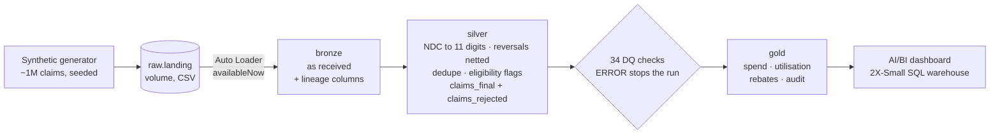

# Pharmacy Claims Lakehouse on Databricks

An end-to-end **PBM pharmacy claims pipeline** built as a medallion lakehouse on **Databricks Free Edition**: synthetic claim files land in a Unity Catalog volume, are ingested with Auto Loader, cleansed and reconciled in silver, checked by 34 data quality rules, and published as gold marts and a two-page AI/BI dashboard. One serverless Job runs it all, from an empty workspace, in about 9 minutes.

It rebuilds the kind of claims pipeline PBM analytics teams typically run on SQL Server, Alteryx and Azure, using modern lakehouse design. All data is synthetic; no employer code or data is used.

**Stack:** Databricks Free Edition · Unity Catalog · Delta Lake · Auto Loader · serverless Jobs · Databricks SQL · AI/BI dashboards · Python (PySpark, pandas) · SQL

---

## Headline results

| | |
|---|---|
| Claim rows received → final paid claims | **998,498 → 887,876**, every row accounted for |
| Specialty share | **1.8% of claims, 57.1% of spend** |
| Utilisation | **12,912** claims per 1,000 members per year · **$282.90** gross cost PMPM |
| Estimated rebate | **$17.14M** on 90,659 brand claims · **$0.58M** double count avoided |
| Rebate leakage | 6,409 claims ($1.38M plan paid) on NDCs missing from the drug file |
| Data quality | 34 checks per run · latest run **33 PASS, 1 WARN** |
| Re-runs | Three runs, identical row counts and dollars in every layer |

The full write-up is in [docs/insights.md](docs/insights.md).

---

## Architecture



Details, including the claim waterfall, data quality gates and orchestration: [docs/architecture.md](docs/architecture.md).


---

## What it demonstrates

**Lakehouse engineering**
- **Incremental, replayable ingestion:** Auto Loader with `availableNow`, checkpoints in their own volume, schema drift rescued, an expected-columns contract, and append-only bronze with `_ingested_at`, `_source_file` and `_run_id`.
- **Idempotent by design:** a seeded generator, Auto Loader skipping files it has already loaded, `CREATE OR REPLACE` for derived tables and `MERGE` for audit history. A re-run loads 0 new bronze rows and rebuilds identical results.
- **Reconciliation at every layer:** each file is checked against a manifest, the silver waterfall is asserted, gold must tie exactly to silver (`raise_error`), and `gold.pipeline_audit` records row counts and dollars per layer per run.
- **Data quality as data:** 34 checks defined in one list, each with a severity (ERROR stops the job, WARN records and continues) and a tolerance. Results are appended to `silver.dq_results` for trending.
- **Orchestration:** one serverless Job with six tasks, job parameters (`{{job.run_id}}` traced through every layer), a DQ gate in front of gold, queued runs and a paused schedule.

**PBM domain logic**
- **NDC normalisation:** 10-digit dashed, 11-digit dashed and lost-leading-zero NDCs are converted to 11-digit 5-4-2 form, then validated against the drug file. 39% of claims needed it.
- **Reversals and duplicates:** reversals are netted by `claim_id` **before** deduplicating on (rx_number, fill_date, pharmacy_npi), so a resent copy of a reversed claim can't come back to life.
- **Reject vs flag:** unusable claims go to `claims_rejected` with a reason code. Usable but questionable claims (outside eligibility, unknown member) stay and are flagged, because they were paid.
- **Utilisation on eligible member-months:** claims per 1,000 and PMPM use member-months, not headcount.
- **Rebate precedence:** one contract per claim (NDC-level beats class-level, then the higher %), which avoids a 3.4% overstatement.
- **NPI validation:** the CMS Luhn check, as a Unity Catalog SQL function.

---

## Dashboard

Two pages on the gold layer: **Spend & utilisation** tells the business story, and **Rebates & data trust** shows the numbers can be trusted (rejects by reason, DQ results, pipeline audit). Ratios are computed in SQL, never averaged in a widget. See [dashboards/README.md](dashboards/README.md).


---

## From a legacy pipeline to the lakehouse

| Typical legacy PBM stack | This project |
|---|---|
| Files dropped on SFTP, loaded by SSIS or Alteryx into staging tables | Files land in a Unity Catalog volume; Auto Loader loads them incrementally, with lineage columns |
| Staging tables truncated on each load | Append-only bronze that can be replayed from any point |
| Cleansing logic spread across Alteryx workflows and stored procedures | One silver notebook in readable SQL, in a fixed order: conform → net → dedupe → validate → flag |
| Row-count checks in a spreadsheet after the load | 34 DQ checks and reconciliations that stop the job before bad numbers are published |
| SQL Agent jobs chained by schedule times | One Job with explicit task dependencies and a DQ gate |
| Reports query the warehouse directly | Gold marts with documented grain, served by an AI/BI dashboard |

---

## Run it yourself

Needs a free [Databricks Free Edition](https://www.databricks.com/learn/free-edition) account. Everything runs on serverless compute within the free quota.

1. **Get the code:** in the workspace, go to **Workspace → Home → Create → Git folder**, paste this repo's URL, and name the folder `pharmacy_claims_lakehouse`.
2. **Create the job:** in [`jobs/pipeline_job.json`](jobs/pipeline_job.json), replace `YOUR_USER_NAME` with your workspace user name. Then either run `databricks jobs create --json @jobs/pipeline_job.json` with the Databricks CLI, or create the six notebook tasks in **Jobs & Pipelines** as listed in the file.
3. **Run it:** click **Run now**. The first run takes about 9 minutes and builds the catalog, data, and all layers.
4. **Load the dashboard:** go to **Dashboards → Create dashboard ▾ → Import dashboard from file** and choose [`dashboards/pharmacy_claims_lakehouse.lvdash.json`](dashboards/pharmacy_claims_lakehouse.lvdash.json).

You can also run the notebooks one by one, in order, from `notebooks/`. Each notebook ends with checks that show PASS or FAIL.

---

## Repository

```
notebooks/
  00_setup_catalog.sql            catalog, schemas, volumes (idempotent)
  01_generate_synthetic_data.py   ~1M messy claims + reference files + manifest
  02_bronze_ingest.py             Auto Loader into bronze, reconciled to the manifest
  03_silver_claims.py             NDC normalisation, netting, dedupe, rejects, flags
  04_silver_dq.py                 34 data quality checks into silver.dq_results
  05_gold_marts.sql               gold marts, reconciliation, pipeline audit
jobs/
  pipeline_job.json               the six-task serverless Job
dashboards/
  datasets/*.sql                  the 9 dashboard datasets
  pharmacy_claims_lakehouse.lvdash.json   exported dashboard
  README.md                       how the dashboard was built
docs/
  architecture.md                 how it works
  design_decisions.md             54 design decisions and why (D1–D54)
  insights.md                     what the gold layer shows
```

---

## Design decisions

Every choice is written down with its reason and the alternative considered, in [docs/design_decisions.md](docs/design_decisions.md). A few worth reading first:

- **D9:** why reversals must be netted before deduplication
- **D16:** why bronze stores every column as a string
- **D26:** reject vs flag
- **D32:** two severities with tolerances, instead of pass/fail on everything
- **D39:** utilisation on eligible member-months
- **D40:** one rebate contract per claim
- **D51:** ratios in SQL, not in dashboard widgets

---

## About

Built by **Kunal**, an analytics manager with 11+ years in PBM and specialty pharmacy analytics. [LinkedIn](https://www.linkedin.com/in/YOUR-PROFILE)

Non-commercial portfolio project. All data is synthetic, and drug and manufacturer names are fictional.
