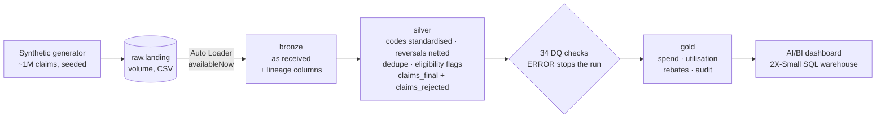

# Pharmacy Claims Lakehouse

**What if we rebuilt the old reporting pipeline properly?**

Many analytics teams still run their reporting on SQL Server and Alteryx pipelines that are hard to re-run, hard to audit, and let bad data reach a dashboard before anyone notices. This project takes that kind of pipeline and rebuilds it as a governed lakehouse on **Databricks Free Edition**.

A million synthetic pharmacy claims, with the mess real files have, flow from raw files through bronze, silver and gold layers to a two-page dashboard. Every row is accounted for, 34 data quality checks stand between the data and the dashboard, and one serverless job runs everything, from an empty workspace, in about 9 minutes.

It is a personal portfolio project. All data is synthetic, and no employer code or data is used.

**Stack:** Databricks Free Edition · Unity Catalog · Delta Lake · Auto Loader · serverless Jobs · Databricks SQL · AI/BI dashboards · Python (PySpark, pandas) · SQL

---

## At a glance

| | |
|---|---|
| Rows received → final claims | **998,498 → 887,876**, every row accounted for |
| Data quality | 34 checks per run · latest run **33 pass, 1 warning** |
| Re-runs | Three runs, identical row counts and amounts in every layer |
| Cost concentration | **1.8% of claims** (specialty drugs) drive **57.1% of spend** |
| Utilisation | **12,912** claims per 1,000 members per year · **$282.90** gross cost per member per month |
| Rebates | **$17.14M** estimated on 90,659 brand claims · **$0.58M** double count avoided |
| Rebate leakage | 6,409 claims ($1.38M paid) on drug codes missing from the drug file |

The figures come from synthetic data, so they show the method, not real-world facts. The full write-up is in [docs/insights.md](docs/insights.md).

---

## From a legacy pipeline to the lakehouse

| Typical legacy reporting stack | This project |
|---|---|
| Files dropped on SFTP, loaded by SSIS or Alteryx into staging tables | Files land in a Unity Catalog volume; Auto Loader loads only new files, with lineage columns |
| Staging tables truncated on each load | Append-only bronze that can be replayed from any point |
| Cleansing logic spread across Alteryx workflows and stored procedures | One silver notebook in readable SQL, in a fixed order: conform → net → dedupe → validate → flag |
| Row-count checks in a spreadsheet after the load | 34 data quality checks and reconciliations that stop the job before bad numbers are published |
| SQL Agent jobs chained by schedule times | One job with explicit task dependencies and a data quality gate |
| Reports query the warehouse directly | Gold tables with a documented grain, served by an AI/BI dashboard |

---

## How it works



| Layer | What happens |
|---|---|
| **Landing** | 24 monthly claim files plus one late file, as CSV. The mess is put in on purpose: mixed drug-code formats, reversals, rebills, duplicates and resends, unknown members, fills outside eligibility |
| **Bronze** | Auto Loader picks up new files only. Every column lands as text, exactly as received, with source file, load time and run ID. Append-only, and reconciled file by file to an answer key |
| **Silver** | Drug codes standardised, reversals netted, **then** duplicates removed. Unusable claims are rejected with a reason; questionable ones are kept and flagged |
| **Data quality** | 34 checks, each with a severity and a tolerance. A pipeline bug stops the job; expected source mess is recorded and reported |
| **Gold** | All SQL, rebuilt every run: spend, utilisation, rebates and an audit table. Eight reconciliation checks against silver; a mismatch stops the job |

Every bronze row ends up as a final claim or as a reject with a reason:

| Step | Rows |
|---|---:|
| Rows received | 998,498 |
| − reversal rows | −37,050 |
| − paid claims cancelled by a reversal | −37,183 |
| − duplicates and resends (latest kept) | −22,617 |
| − drug codes that can't be read | −7,363 |
| − drug codes not in the drug file | −6,409 |
| **= final claims** | **887,876** |

Full details, including the data quality gates and orchestration: [docs/architecture.md](docs/architecture.md).

---

## What it demonstrates

**Lakehouse engineering**
- **Incremental, replayable ingestion:** Auto Loader with `availableNow`, checkpoints in their own volume, schema drift rescued, an expected-columns contract, and append-only bronze with `_ingested_at`, `_source_file` and `_run_id`.
- **Safe to re-run:** a seeded generator, Auto Loader skipping files it has already loaded, `CREATE OR REPLACE` for derived tables and `MERGE` for audit history. A re-run loads 0 new bronze rows and rebuilds identical results.
- **Reconciliation at every layer:** each file is checked against a manifest, the silver waterfall is asserted, gold must tie exactly to silver (`raise_error`), and `gold.pipeline_audit` records row counts and amounts per layer per run.
- **Data quality as data:** 34 checks defined in one list, each with a severity (ERROR stops the job, WARN records and continues) and a tolerance. Results are appended to `silver.dq_results`, so trends are visible.
- **Orchestration:** one serverless job with six tasks, job parameters (`{{job.run_id}}` traced through every layer), a data quality gate in front of gold, queued runs and a paused schedule.

**Business logic in the model**
- **Drug codes standardised:** the US drug code (NDC) arrives in several formats; all are converted to one 11-digit form, then checked against the drug file. 39% of claims needed it.
- **Cancel before de-duplicating:** reversals are netted **before** duplicates are removed. Done the other way round, a resent copy of a cancelled claim comes back as paid.
- **Reject only what can't be used; flag the rest:** a claim paid outside a member's eligibility still cost money, so it stays in spend, flagged for recovery.
- **Utilisation on eligible member-months,** not headcount, so members covered for only part of the period are counted correctly.
- **One rebate contract per claim:** when two contracts match, a precedence rule picks one, which avoids a 3.4% overstatement of rebates.
- **Provider ID validation:** the official check-digit rule for US provider IDs (NPI), as a Unity Catalog SQL function.

---

## Dashboard

Two pages on the gold layer. **Spend & utilisation** tells the business story; **Rebates & data trust** shows why the numbers can be trusted, with rejects by reason, data quality results and the pipeline audit. Ratios are computed in SQL, never averaged in a widget.

**[See the published dashboard (PDF, both pages)](dashboards/dashboard.pdf)** · how it was built: [dashboards/README.md](dashboards/README.md)

---

## Design decisions

All 54 choices are written down with the reason and the alternative considered, in [docs/design_decisions.md](docs/design_decisions.md). Good ones to start with:

- **D9:** why reversals must be netted before de-duplication
- **D16:** why bronze stores every column as text
- **D26:** reject vs flag
- **D32:** two severities with tolerances, instead of pass/fail on everything
- **D39:** utilisation on eligible member-months
- **D40:** one rebate contract per claim
- **D51:** ratios in SQL, not in dashboard widgets

---

## Run it yourself

You need a free [Databricks Free Edition](https://www.databricks.com/learn/free-edition) account. Everything runs on serverless compute within the free quota.

1. **Get the code:** in the workspace, go to **Workspace → Home → Create → Git folder**, paste this repo's URL, and name the folder `pharmacy_claims_lakehouse`.
2. **Create the job:** in [`jobs/pipeline_job.json`](jobs/pipeline_job.json), replace `YOUR_USER_NAME` with your workspace user name. Then either run `databricks jobs create --json @jobs/pipeline_job.json` with the Databricks CLI, or create the six notebook tasks in **Jobs & Pipelines** as listed in the file.
3. **Run it:** click **Run now**. The first run takes about 9 minutes and builds the catalog, data and all layers.
4. **Load the dashboard:** go to **Dashboards → Create dashboard ▾ → Import dashboard from file** and choose [`dashboards/pharmacy_claims_lakehouse.lvdash.json`](dashboards/pharmacy_claims_lakehouse.lvdash.json).

You can also run the notebooks one by one, in order, from `notebooks/`. Each notebook ends with checks that show PASS or FAIL.

---

## Repository

```
notebooks/
  00_setup_catalog.sql            catalog, schemas, volumes (idempotent)
  01_generate_synthetic_data.py   ~1M messy claims + reference files + manifest
  02_bronze_ingest.py             Auto Loader into bronze, reconciled to the manifest
  03_silver_claims.py             code standardisation, netting, dedupe, rejects, flags
  04_silver_dq.py                 34 data quality checks into silver.dq_results
  05_gold_marts.sql               gold tables, reconciliation, pipeline audit
jobs/
  pipeline_job.json               the six-task serverless job
dashboards/
  datasets/*.sql                  the 9 dashboard datasets
  pharmacy_claims_lakehouse.lvdash.json   exported dashboard
  README.md                       how the dashboard was built
docs/
  architecture.md                 how it works
  design_decisions.md             54 design decisions and why (D1–D54)
  insights.md                     what the gold layer shows
```

---

## Glossary

The data follows US pharmacy claims conventions. The few terms used above:

| Term | Meaning |
|---|---|
| **NDC** | National Drug Code, the US product code for a drug package |
| **NPI** | National Provider Identifier, the US ID for a pharmacy or prescriber |
| **Reversal** | A claim that cancels an earlier one, sent as its own row with negative amounts |
| **Rebate** | A payment from a drug manufacturer, set by contract as a percentage of the drug's cost |
| **Per member per month** | Cost divided by the number of months members were eligible |

---

## About

Built by **Kunal Sharma**, a hands-on analytics lead in Rotterdam with 12 years across healthcare, financial services and consulting. [Portfolio](https://kshar00.github.io) · [LinkedIn](https://www.linkedin.com/in/kunalsharma8)

Non-commercial portfolio project. All data is synthetic, and drug and manufacturer names are fictional.
