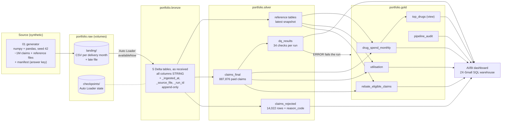
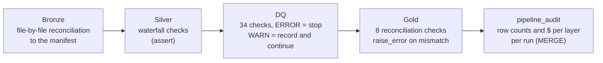
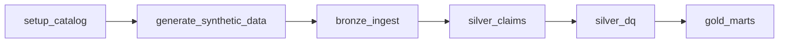

# Architecture

A medallion lakehouse for pharmacy (PBM) claims, built entirely on **Databricks Free Edition**: serverless compute, Unity Catalog, Python and SQL only.

This page covers **how** the pipeline is built. The **why** behind each choice is in [design_decisions.md](design_decisions.md) (decisions D1–D54, referenced below).

---

## 1. End to end

All six steps run as one serverless Databricks Job (section 5).

---

## 2. Unity Catalog layout

One catalog with four schemas (D1). Free Edition has a single metastore, so the layers are schemas rather than separate catalogs.

| Object | Type | Holds |
|---|---|---|
| `portfolio.raw.landing` | Managed volume | The CSV files exactly as "delivered", plus `_manifest/generation_manifest.json` |
| `portfolio.raw.checkpoints` | Managed volume | Auto Loader checkpoints and schema locations, one folder per source |
| `portfolio.bronze` | Schema | `claims`, `drug_reference`, `members`, `pharmacies`, `rebate_contracts` |
| `portfolio.silver` | Schema | `claims_final`, `claims_rejected`, conformed reference tables, `dq_results`, `dq_results_latest` (view), `is_valid_npi` (SQL function) |
| `portfolio.gold` | Schema | `drug_spend_monthly`, `utilisation`, `top_drugs` (view), `rebate_eligible_claims`, `pipeline_audit` |

Every table and view has a `COMMENT`, so Catalog Explorer documents itself, and Unity Catalog records lineage from landing to the dashboard automatically.

---

## 3. Layers

| Layer | Notebook | Write pattern | Key logic |
|---|---|---|---|
| **Landing** | `01_generate_synthetic_data.py` | Overwrite files (seeded, so identical every run) | 24 monthly claim deliveries plus one late file. Messiness injected on purpose: mixed NDC formats, reversals, rebills, exact and resent duplicates, orphan reversals, unknown members, fills outside eligibility (D5–D14) |
| **Bronze** | `02_bronze_ingest.py` | Auto Loader `availableNow`, append-only | Load as received, all columns as strings (D16), schema drift rescued, lineage columns added. Each file reconciled to the manifest (D15–D22) |
| **Silver** | `03_silver_claims.py` | `CREATE OR REPLACE` | Normalise NDC to 11 digits (5-4-2), net reversals by `claim_id`, **then** dedupe on (rx_number, fill_date, pharmacy_npi) keeping the latest delivery, check NDC against drug reference, flag eligibility (D23–D30) |
| **DQ** | `04_silver_dq.py` | Append to `dq_results` | 34 checks in five groups (completeness, uniqueness, nulls, referential, validity), each with a severity and a tolerance. Any `ERROR` failure stops the job (D31–D36) |
| **Gold** | `05_gold_marts.sql` | `CREATE OR REPLACE`; audit by `MERGE` | Spend, utilisation per 1,000 on eligible member-months, one rebate contract per claim, reconciliation to silver with `raise_error` (D37–D43) |
| **Serve** | `dashboards/` | Published dashboard | Ratios computed in SQL, two pages: business story, then data trust (D49–D54) |

### Claim waterfall: bronze → silver

Every bronze row is accounted for, either as a final claim or as a reject with a reason. This waterfall is checked against the generator's manifest on every run.

| Step | Rows | Running total |
|---|---:|---:|
| Bronze claim rows received | 998,498 | |
| − reversal rows (negative amounts) | −37,050 | 961,448 paid rows |
| − paid rows cancelled by a matching reversal | −37,183 | |
| − duplicates removed (exact copies and resends, latest kept) | −22,617 | 901,648 |
| − `INVALID_NDC_FORMAT` (can't be parsed to 11 digits) | −7,363 | |
| − `NDC_NOT_IN_REFERENCE` (valid NDC, missing from the drug file) | −6,409 | |
| **= `silver.claims_final`** | | **887,876** |

`silver.claims_rejected` holds 14,022 rows: the two NDC reasons above plus 250 `ORPHAN_REVERSAL` (reversals of claims never received). **Netting comes before dedupe** (D9): if the order were reversed, a resent copy of a reversed claim could survive as a "paid" claim.

### Reject vs flag

Silver separates claims it **can't use** from claims that are **usable but questionable** (D26).

| Rejected (to `claims_rejected`) | Kept and flagged (in `claims_final`) |
|---|---|
| NDC can't be normalised or isn't in the drug file: the claim can't be priced, classed or rebated | Fill outside member eligibility (`is_eligible_on_fill_date`): the claim was paid, which is a recovery question, not a data error |
| Reversal with no original claim | Member or pharmacy not in reference files (`member_found`, `pharmacy_found`) |
| | Prescriber missing, rebill (`prescriber_missing`, `is_rebill`) |

---

## 4. Data quality and reconciliation

Three independent safety nets, each able to stop the pipeline:

- **Severity and tolerance** (D32): `ERROR` with 0% tolerance is for what silver guarantees (unique keys, no null amounts). `WARN` with a tolerance is for expected source messiness. The latest run: **33 PASS, 1 WARN** (1.50% of claims filled outside eligibility, over the 1.0% tolerance).
- **History** (D33): `dq_results` is append-only, so check results can be trended across runs.
- **Gold reconciliation** (D42): gold claim counts, gross cost and plan paid must equal `silver.claims_final` exactly, and rebate claims must be unique, brand-only and inside contract dates.

---

## 5. Orchestration

- **One job, six serverless notebook tasks in a straight line** (D44), defined in [`jobs/pipeline_job.json`](../jobs/pipeline_job.json).
- **Job parameters** (D46): `catalog`, `run_id = {{job.run_id}}` and `reset`. One run id flows into bronze (`_run_id`), DQ (`dq_results.run_id`) and gold (`pipeline_audit.run_id`), so a single run can be traced through every layer.
- **Gate** (D45): `gold_marts` runs only if `silver_dq` succeeds. A failed ERROR check means the dashboard keeps showing the last good numbers.
- **Safe to re-run** (D47): the generator is seeded, Auto Loader skips files it has already loaded (bronze adds 0 rows on a re-run), silver and gold rebuild to identical results, and the audit `MERGE`s on the new run id. Three runs in `pipeline_audit` show identical row counts and dollars.
- **Run time:** about 9 minutes end to end. The first task takes ~5 minutes, mostly serverless start-up; the five data tasks take 41–51 seconds each.

---

## 6. Working within Free Edition

| Constraint | How the design handles it |
|---|---|
| Serverless only, no cluster config | Every task is a notebook task with no cluster definition. No caching or Spark config tuning is relied on |
| Streaming limits on serverless | Auto Loader uses `trigger(availableNow=True)`: incremental and checkpointed, but it stops when caught up (D15) |
| Daily compute quota | ~1M claims, gold tables are small aggregates, the job schedule is created **paused**, and the dashboard has no refresh schedule (D47, D54) |
| One 2X-Small SQL warehouse | Dashboard datasets read gold aggregates (largest ~11.5k rows), never raw claims |
| Max 5 concurrent tasks | The job runs one task at a time, and `max_concurrent_runs = 1` queues a second trigger |
| Python and SQL only | Generator, bronze and DQ in Python; silver and gold mostly SQL |

---

## 7. What would change in production

| Area | Here | Production |
|---|---|---|
| Pipeline framework | Notebooks + Job | Lakeflow Declarative Pipelines with expectations, or the same notebooks deployed by Databricks Asset Bundles per environment |
| Members | Latest snapshot | SCD Type 2 history, so eligibility is checked against the record valid on the fill date |
| Rebate basis | Ingredient cost × % | WAC price file × units, with contract tiers and market-share terms |
| Ingestion | Files written by a generator | Files landed by SFTP or cloud storage events, with Auto Loader in file-notification mode |
| Silver writes | Full rebuild (`CREATE OR REPLACE`) | Incremental `MERGE` on the business key once volumes grow |
| Access | Single owner | Unity Catalog grants per schema, with row filters or column masks for member data |
